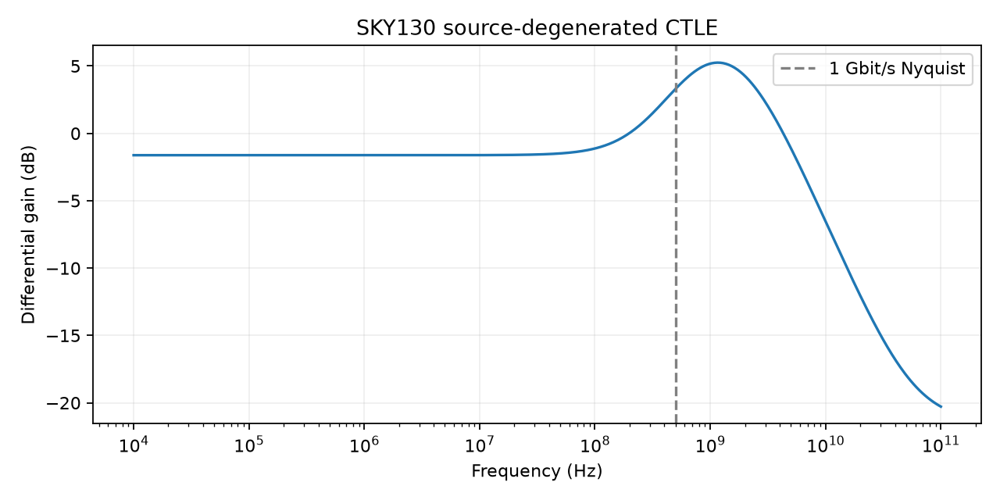
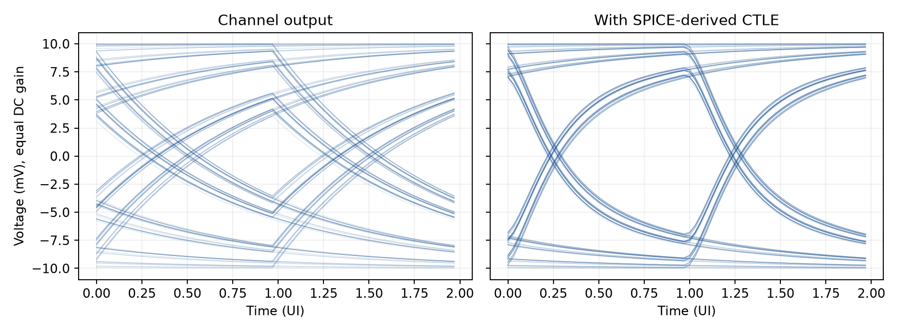

# LinkScope — CMOS CTLE and receiver equalization

A transistor-level differential continuous-time linear equalizer (CTLE), followed by a clearly separated small-signal NRZ link experiment. The receiver front end uses SKY130 NMOS devices, resistor loads, a current-mirror bias and a capacitor bypassing source degeneration.



## Measured simulation results

Nominal: TT, 1.8 V, 27 °C; source resistors 750 Ω, differential degeneration capacitor 0.4 pF, drain loads 1 kΩ, explicit load capacitance 0.1 pF per side.

| Metric | Result |
|---|---:|
| Low-frequency differential gain | -1.62 dB |
| Gain at 500 MHz | 3.30 dB |
| Boost at 500 MHz relative to DC | 4.92 dB |
| Peak gain / frequency | 5.25 dB / 1.155 GHz |
| Bias power, reference included | 0.894 mW |

A **20-configuration R/C sweep** and **45-condition PVT matrix** are executed. The PVT sweep combines TT/SS/FF/SF/FS, 1.71/1.80/1.89 V and −40/27/85 °C. Simulated Nyquist boost spans 4.63–5.26 dB.

## Small-signal link experiment

An explicit 180 MHz one-pole channel carries a seeded 8192-bit, 1 Gbit/s NRZ sequence with ±10 mV symbols. A causal, stable three-pole/one-zero model is fitted to the SPICE complex AC response. Maximum relative complex fit error over 10 kHz–4 GHz is **0.246%**. The fitted model is used in a causal digital filter; no finite-band inverse-FFT pre-response is used.

At equal DC gain, evaluated vertical eye separation improves from **7.10 to 13.86 mV** on 6080 held-out bits. Sampling phase is chosen using a separate training segment. Eye separation is the first percentile of logical-one samples minus the 99th percentile of logical-zero samples.



This eye result is **linearized and noiseless**, with no clock recovery, random jitter, nonlinear saturation or BER claim. AC gain/phase and noise are transistor-level SPICE results; the eye diagram is not a transistor transient simulation and not a measured link.

## Reproduce

Prerequisites: Python 3.12 and `ngspice`.

```sh
python3 -m venv .venv
. .venv/bin/activate
python -m pip install -r requirements.txt
make verify
```

Eight tests check model provenance, the complete PVT matrix, gain relations, R/C tradeoffs, stable-fit accuracy, held-out eye evaluation, noise/power and netlist/report consistency. CI reruns all analyses. JSON evidence lives in [reports/characterization.json](reports/characterization.json); original licensed models are in [models/](models/README.md).

## Scope

This is a receiver-front-end study using a public 130 nm model set. It is not a PCIe/SerDes-compliant PHY, a tapeout or a signoff-grade equalizer. Layout, package/channel S-parameters, common-mode adaptation, offset cancellation, mismatch, CDR and extracted parasitics are outside scope. Input common mode is externally supplied at 1.2 V. The current mirror uses an ideal reference source.
